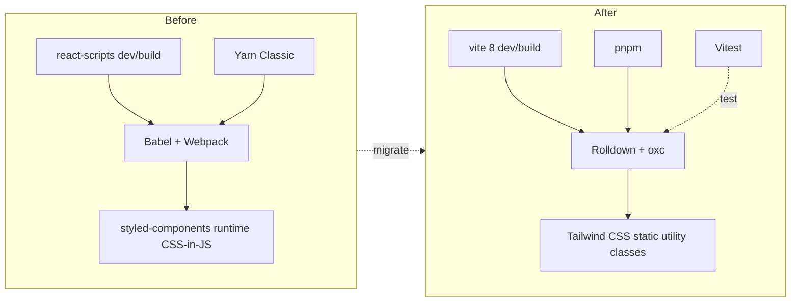

# Toolchain Refactor: Vite 8 + pnpm + Tailwind CSS

**PRD ID**: PRD-2026-05-24-0733
**Status**: Phase 1 implemented (pending in-browser smoke test); Phases 2–3 not started
**Complexity**: High
**Created**: May 24, 2026
**Author**: thetnaingtn

---

## Problem

The project is built on Create React App (`react-scripts` 4), Yarn Classic, React 17, and `styled-components` 5. CRA is unmaintained, the dev server is slow, the build pipeline is opaque, and `styled-components/macro` depends on Babel plugins that CRA owns. Yarn Classic is also legacy; the team standard is moving to pnpm for faster installs and a stricter dependency graph.

The TypeScript migration is partially done (a few `.js` files remain, e.g. `src/components/form/styles.js`). Continuing on CRA blocks further modernization (React 18 features, faster HMR, modern ESM-only libraries) and adds friction every time a new contributor sets up the repo.

## Solution

Replace the toolchain end-to-end while keeping app behavior identical:

1. Swap **CRA → Vite 8** (Rolldown-bundled, Rust-powered) with `@vitejs/plugin-react@^6` (oxc-based, no Babel) and TypeScript already enabled.
2. Swap **Yarn → pnpm**; delete `yarn.lock`, commit `pnpm-lock.yaml`.
3. Swap **styled-components → Tailwind CSS** (utility-first); delete all `styles.ts` / `styles.js` files and inline classNames on the JSX they previously styled.
4. Bump **React 17 → React 18** (`createRoot` API) as part of the same change, since Vite scaffolding assumes it.
5. Finish the TypeScript migration — no `.js` files remain after this PRD.

## Summary

_To be completed after implementation._

---

## Scope

### In Scope

- Replace `react-scripts` with Vite 8 (Rolldown-bundled) + `@vitejs/plugin-react@^6` (oxc-based; no Babel runtime dependency)
- Migrate `package.json` scripts (`start` → `dev`, `build`, `preview`, `test`)
- Move `public/index.html` to project root as Vite expects, with `%PUBLIC_URL%` swapped for Vite-style asset references
- Switch package manager to pnpm; add `packageManager` field and `engines`
- Install and configure Tailwind CSS (v4) via the `@tailwindcss/vite` plugin (no PostCSS pipeline)
- Convert every `styled-components` styled element into JSX with Tailwind classes
- Remove `styled-components`, `styled-components/macro`, and their type packages
- Upgrade React + React DOM to 18; switch `ReactDOM.render` → `createRoot`
- Convert `src/components/form/styles.js` and any remaining `.js` files to `.ts` / `.tsx`
- Replace `react-scripts test` with **Vitest** + `@testing-library/react` (CRA's Jest setup does not survive)
- Update ESLint config to one that does not depend on `react-scripts` (flat config with `eslint-plugin-react`, `eslint-plugin-react-hooks`, `@typescript-eslint`)
- Update the five existing `CLAUDE.md` files plus the root `CLAUDE.md` to reflect the new toolchain

### Out of Scope

- Visual redesign — the UI must look pixel-identical after migration (Tailwind classes reproduce the existing styles)
- Behavioral changes to grid generation, validation, or clipboard logic
- New features (responsive overhaul, dark mode, presets, etc.) — track separately
- CI/CD pipeline setup (no existing CI to update)
- Deployment / hosting changes

### Target Users

| Role             | Impact                                                                                              |
| ---------------- | --------------------------------------------------------------------------------------------------- |
| Maintainer (you) | Faster dev server, modern tooling, cleaner dependency tree, one styling system instead of two       |
| Future contributors | Standard Vite + Tailwind stack lowers onboarding cost; `pnpm install` is faster and stricter     |
| End users        | No functional change; bundle size should drop (no styled-components runtime), first paint improves  |

---

## Technical Design

### Architecture



### Database Changes

| Table | Change | Reason |
| ----- | ------ | ------ |
| n/a   | n/a    | This project has no database — pure client-side React app |

### Backend

| Component   | Changes                                                                                             |
| ----------- | --------------------------------------------------------------------------------------------------- |
| Controllers | n/a — no backend                                                                                    |
| Services    | n/a — no backend                                                                                    |
| Models      | n/a — no backend                                                                                    |
| Routes      | n/a — no backend                                                                                    |
| Build       | `react-scripts` removed; `vite.config.ts` added with `@vitejs/plugin-react` and `@tailwindcss/vite` |
| Tooling     | `pnpm-lock.yaml` replaces `yarn.lock`; `packageManager: "pnpm@11.1.2"` declared in `package.json`; `pnpm-workspace.yaml` + `.npmrc` added for pnpm 11 build-approval gating |

### Frontend

| Component  | Changes                                                                                                       |
| ---------- | ------------------------------------------------------------------------------------------------------------- |
| Entry      | `src/index.tsx` rewritten to use `createRoot` (React 18); `index.html` moved to project root                  |
| App shell  | `src/App.tsx` — `StylesApp` styled-component replaced with `<div className="mx-[5vmin] mt-[5vmin]">`         |
| Components | All `src/components/*/styles.{ts,js}` deleted; each `index.tsx` gets Tailwind classNames inline               |
| Container  | `src/container/wrapper.ts` deleted; replaced by a Tailwind-classed wrapper inline in `App.tsx`               |
| Global     | `src/global-styles.ts` replaced by `src/index.css` with `@tailwind base/components/utilities`                  |
| Types      | No type changes; all existing exported types (`ErrorType`, `GridUnitType`, etc.) remain stable                |
| Tests      | Jest → Vitest; `src/setupTests.ts` rewritten for Vitest globals                                                |

---

## Implementation

### Phase 1: Toolchain swap (Vite + pnpm + React 18) — **complete (pending in-browser smoke test)**

See `docs/PRDs/active/phases/2026-05-24-0733-toolchain-refactor-vite-pnpm-tailwind-phase-1-toolchain-swap.md` for full task list and implementation notes. Key changes from this top-level outline:

- pnpm pinned to **`@11.1.2`** (not 9.x). pnpm 11's build-approval model requires `pnpm-workspace.yaml` `allowBuilds: { esbuild: true }` plus `.npmrc` `verify-deps-before-run=false`.
- React plugin pinned to **`@vitejs/plugin-react@^6`** (oxc-powered, Rolldown-aligned). The 4.x line still works against Vite 8 but emits a per-build Babel deprecation warning; v6 removes it.
- Vitest pinned to **`@4`** (not the unversioned suggestion). Vitest 2.x ships Vite 5 type defs that conflict with Vite 8 under project references.
- `vite.config.ts` imports `defineConfig` from `"vitest/config"` (the triple-slash `/// <reference types="vitest" />` workaround did not augment Vite 8's `UserConfig`).
- `tsconfig.node.json` uses `composite: true` + `emitDeclarationOnly: true` + an out-of-tree `outDir` (composite projects forbid `noEmit`).
- `tsconfig.json` `types` is `["vite/client"]` only — `vitest/globals` is unnecessary since the config imports from `vitest/config` directly.
- **`styled-components/macro` imports were rewritten to plain `styled-components` in Phase 1** because Rolldown fails the build on the missing `css` ESM export. Phase 2 still deletes the styled-components code entirely.
- Flat ESLint config demotes several legacy rules (`prefer-const`, `react/no-unescaped-entities`, `react/display-name`, `@typescript-eslint/no-empty-object-type`) to keep this phase free of unrelated cleanup. Phase 3 re-enables them.
- `.gitignore` now ignores `/dist` and `*.tsbuildinfo`.

- [x] All Phase 1 implementation tasks (1–10) completed; lint, typecheck, build, dev, and preview all green. Interactive UI smoke test still pending.

### Phase 2: Tailwind setup + styled-components removal

- [ ] Install `tailwindcss@^4` and `@tailwindcss/vite`; register the plugin in `vite.config.ts` (do not add a PostCSS config)
- [ ] Create `src/index.css` with `@import "tailwindcss";` (v4 syntax) and import it from `src/index.tsx`
- [ ] Confirm no `postcss.config.{js,cjs,mjs,ts}` file exists — the `@tailwindcss/vite` plugin handles CSS transformation directly
- [ ] Delete `src/global-styles.ts`; port any global resets / font imports into `src/index.css`
- [ ] Configure Tailwind theme (custom colors, fonts) to match the current palette — extract from existing `styles.ts` files
- [ ] Migrate `src/components/grid/styles.ts` → inline Tailwind classes in `grid/index.tsx`
- [ ] Migrate `src/components/form/styles.js` → inline Tailwind classes in `form/index.tsx` (also finishes TS migration of this file)
- [ ] Migrate `src/components/code/styles/code.ts` → Tailwind in `code/index.tsx`
- [ ] Migrate `src/components/explain/styles.ts` → Tailwind in `explain/index.tsx`
- [ ] Migrate `src/components/modal-dialog/`, `header/` to Tailwind (no existing styles files in `header/`; verify modal styling)
- [ ] Migrate `src/container/wrapper.ts` → inline Tailwind in `App.tsx`; delete the file
- [ ] Remove `styled-components`, `@types/styled-components`, `babel-plugin-styled-components` from `package.json`
- [ ] `grep -r "styled-components"` returns zero results; `grep -r "\.styles"` only matches CSS files or comments
- [ ] Note: `styled-components/macro` imports were already rewritten to plain `styled-components` in Phase 1 (Rolldown build constraint) — no `/macro` references remain to clean up

### Phase 3: Tests, docs, and verification

- [ ] Convert any existing `*.test.tsx` from Jest globals to Vitest (likely zero or one file — CRA template default). Vitest is installed at **v4**; verify import paths against Vitest 4 API
- [ ] Re-tighten the ESLint rules demoted in Phase 1's `eslint.config.js`: `prefer-const`, `react/no-unescaped-entities`, `react/display-name`, `@typescript-eslint/no-empty-object-type` back to errors; `no-unused-vars` / `no-explicit-any` back to errors (most violations live in `styled-components` files deleted by Phase 2)
- [ ] Add a smoke test that renders `<App />` and asserts the header is in the document
- [ ] Add a Vitest test for `utils/validatator.ts` (covers `fr`, `px`, `auto`, and an invalid unit)
- [ ] Add a Vitest test for `utils/repetition.ts` (`groupRepeatedUnits` + `createRepetition` round-trip)
- [ ] Update root `CLAUDE.md`: replace `yarn`/CRA commands with `pnpm dev/build/test`; remove `styled-components/macro` rule; mention Tailwind and Vite 8
- [ ] Update `src/components/CLAUDE.md`: drop `styled-components/macro` guidance; describe Tailwind class conventions and where to put long class lists (e.g. `clsx` / `tailwind-merge` if introduced)
- [ ] Update `src/container/CLAUDE.md`: remove `wrapper.ts` reference
- [ ] Update `src/context/`, `src/hooks/`, `src/utils/` CLAUDE.md files where they mention legacy `.js` files
- [ ] Update `README.md` install + run instructions to pnpm + Vite
- [ ] Manual smoke test (see Testing section) — must look pixel-identical to current `main`

---

## Security

| Concern          | Mitigation                                                                                              |
| ---------------- | ------------------------------------------------------------------------------------------------------- |
| Authorization    | n/a — no auth, no backend, fully client-side                                                            |
| Input validation | Existing `utils/validatator.ts` continues to gate CSS unit input on the grid form; no change needed     |
| Data exposure    | No user data, no network calls, no telemetry — only the generated CSS string lives in client memory     |
| Supply chain     | pnpm's strict resolution + lockfile reduces phantom dependency risk vs. Yarn Classic's hoisted layout  |
| XSS              | `dangerouslySetInnerHTML` is not used; `execCommand("copy")` operates on a local DOM selection only     |

---

## Testing

**Automated:**

```bash
pnpm install
pnpm lint
pnpm exec tsc --noEmit
pnpm test --run
pnpm build
pnpm preview
```

**Manual Verification:**

1. `pnpm dev`, open `http://localhost:5173` — header, grid, form, and code panel all render
2. Change column / row counts via the form — grid resizes; no console errors
3. Drag-select a region in the grid — a child area appears; the generated CSS in the code panel updates
4. Toggle the code panel between CSS and HTML views — both render with the syntax-highlighted spans
5. Click "Copy to Clipboard" — button text changes to "Code Copied" for 3 seconds
6. Enter an invalid unit (e.g. `5foo`) in a column-size input — inline error appears; valid units (`1fr`, `100px`, `auto`) clear it
7. Open the modal-dialog (the "wat" link) — overlay renders and closes correctly
8. Resize the viewport below 700px — layout collapses to single column (media-query parity)
9. `pnpm build && pnpm preview` — production bundle behaves identically; check Network tab for missing assets
10. Compare against `main` branch visually — no pixel-level regressions in grid lines, gaps, fonts, colors

---

## Risks

| Risk                                                                                            | Likelihood | Mitigation                                                                                                                       |
| ----------------------------------------------------------------------------------------------- | ---------- | -------------------------------------------------------------------------------------------------------------------------------- |
| Vite 8 is very new; plugin ecosystem (`@tailwindcss/vite`, Vitest, `@vitejs/plugin-react`) may have integration bugs | Medium     | Pin exact versions; use `@vitejs/plugin-react@^6` (oxc) which is the version aligned with Vite 8's Rolldown bundler; fallback plan to Vite 7 if a blocker appears |
| `@tailwindcss/vite` peer-deps may lag behind Vite 8 majors                                      | Medium     | Check `@tailwindcss/vite` release notes before install; if incompatible, temporarily fall back to Vite 7 (do not switch to PostCSS) |
| Tailwind class soup makes complex grid styles (dynamic `grid-template-columns`) hard to express | High       | Use inline `style={{ gridTemplateColumns: columnTemplate }}` for genuinely dynamic values; Tailwind only for static classes      |
| React 18's strict-mode double-invocation exposes bugs in `useEffect` chains (esp. `gridContext`) | Medium     | Test grid context effects in dev with `<StrictMode>`; fix any double-fire issues before declaring done                           |
| `styled-components/macro` removal breaks readable class names — debugging becomes harder        | Low        | Tailwind classes are inherently readable; `data-testid` added to key elements during migration                                   |
| Pixel drift between styled-components output and Tailwind reproduction                          | Medium     | Side-by-side screenshot comparison before merging; use Tailwind arbitrary values (`mx-[5vmin]`) to match exact CSS               |
| Removing `react-scripts test` loses any snapshot tests                                          | Low        | Repo has no committed test files today (verify with `find src -name "*.test.*"`); add new Vitest tests in Phase 3                |
| `setRowArr`/`setColArr` effect ordering in `gridContext` regresses under React 18 batching     | Low        | Phase 3 includes a manual smoke test for resize/gap interactions specifically                                                    |

---

## Definition of Done

- [ ] Implementation complete (Phases 1–3)
- [ ] Tests passing (`pnpm test --run`)
- [ ] Security verified (no new network surfaces, no new user input paths)
- [ ] Lint / type checks clean (`pnpm lint`, `pnpm exec tsc --noEmit`)
- [ ] `pnpm build && pnpm preview` produces a working bundle
- [ ] Visual parity with `main` confirmed by manual smoke test
- [ ] All `CLAUDE.md` files updated to reflect new toolchain
- [ ] `README.md` updated
- [ ] PR approved and merged

---

## Files Changed

| Category   | Files                                                                                          | Description                                                                                  |
| ---------- | ---------------------------------------------------------------------------------------------- | -------------------------------------------------------------------------------------------- |
| Tooling    | `package.json`, `pnpm-lock.yaml` (new), `yarn.lock` (deleted), `pnpm-workspace.yaml` (new), `.npmrc` (new) | Switch package manager, drop CRA deps, add Vite/Vitest/Tailwind; pnpm 11 build-approval config |
| Build      | `vite.config.ts` (new), `tsconfig.json`, `tsconfig.node.json` (new), `eslint.config.js` (new)  | Vite config, TS bundler resolution, flat ESLint                                              |
| HTML       | `index.html` (moved from `public/`), `public/` (asset-only)                                   | Vite entry HTML at project root                                                              |
| Styling    | `src/index.css` (new), `src/global-styles.ts` (deleted), all `src/**/styles.{ts,js}` (deleted) | Tailwind v4 entry; remove styled-components artifacts                                        |
| Entry      | `src/index.tsx`, `src/App.tsx`                                                                 | `createRoot`, Tailwind import, inline classNames                                             |
| Components | `src/components/{grid,form,code,explain,modal-dialog,header}/index.tsx`                        | Replace styled imports with Tailwind classes; finish `.js` → `.tsx` for `form/`              |
| Container  | `src/container/code.tsx`, `src/container/wrapper.ts` (deleted)                                 | Inline Tailwind wrapper in `App.tsx`                                                         |
| Tests      | `src/setupTests.ts` (rewritten), `src/utils/*.test.ts` (new), `src/App.test.tsx` (new)         | Vitest setup, unit + smoke coverage                                                          |
| Docs       | `CLAUDE.md`, `src/{components,container,context,hooks,utils}/CLAUDE.md`, `README.md`           | Reflect pnpm + Vite + Tailwind                                                               |

---

## Related

- **Issues**: _none yet_
- **PRs**: _none yet_
- **Docs**: [Vite migration from CRA](https://vite.dev/guide/), [Tailwind v4 docs](https://tailwindcss.com/), [pnpm migration](https://pnpm.io/installation)

---

_Last updated: May 24, 2026_
